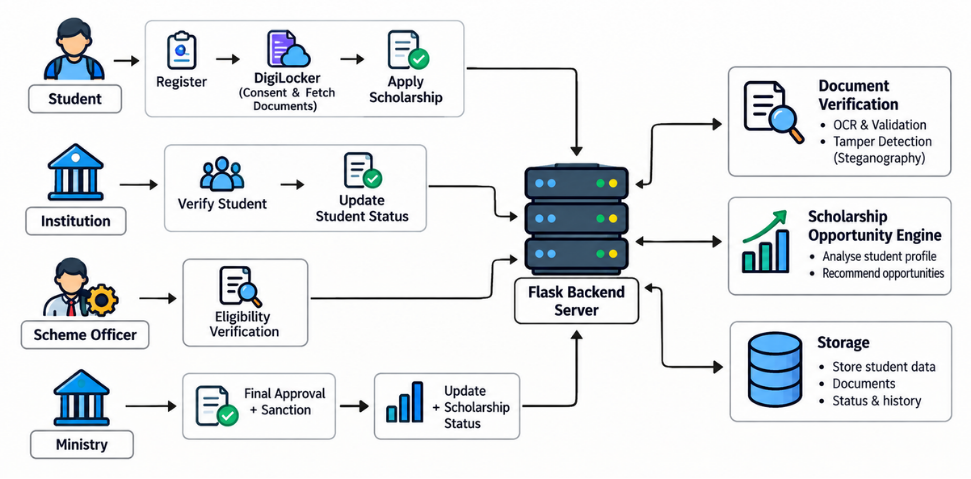
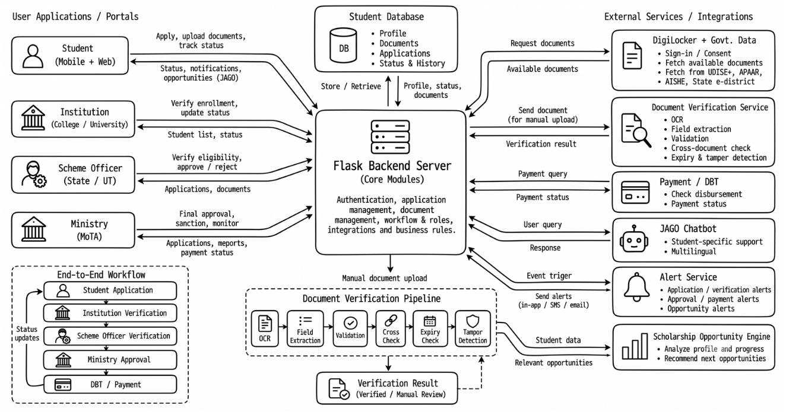

# Unified Scholarship Platform for Tribal Students

**Problem Statement ID:** 26238  
**Ministry:** Ministry of Tribal Affairs (MoTA), Government of India  
**Category:** Software | **Theme:** Smart Automation  

---

## 1. Solution

The **Unified Scholarship Platform for Tribal Students** is a centralized, mobile-first and web-accessible digital platform designed to streamline the complete scholarship lifecycle for Scheduled Tribe (ST) students across India.

It unifies disparate schemes (Pre-Matric, Post-Matric, Top Class, National Fellowship for ST Students, and National Overseas Scholarship) into a single, cohesive ecosystem.

### Key Capabilities
* **Unified Student Profile:** Single registration and reusable profile across multiple scholarship schemes, eliminating repetitive data entry.
* **Smart DigiLocker Integration:** One-click consent-based fetching of verified government credentials (Caste/ST Certificate, Income Certificate, Domicile, Marksheets).
* **Hybrid Document Handling:** Automated reuse of DigiLocker documents with seamless fallback to manual uploads when documents are unavailable.
* **Intelligent Document Verification:** Automated multi-stage verification pipeline for manually uploaded documents featuring OCR, field extraction, cross-document matching, validity checks, and steganography-based tamper detection.
* **Continuous Institutional Lifecycle Tracking:** Direct institution portal for real-time verification of genuine enrollment and continuous lifecycle status updates (Active, Transferred, Dropped Out, Passed Out).
* **Multi-Tier Portals:** Role-based portals for Students, Educational Institutions, State Scheme Officers, and Ministry Administrators.
* **JAGO AI Student Assistant:** Context-aware, student-specific multilingual virtual assistant providing personalized guidance on application status, missing documents, eligibility, and disbursement.
* **Proactive Notification Engine:** Automated event-driven alerts for application progress, document deficiencies, institutional verification, approvals, sanctions, and payment credits.
* **Scholarship Continuity & Opportunity Engine:** Progression-aware recommendation system that maps a student\'s academic path and proactively identifies relevant future scholarships, fellowships, and higher education avenues.

---

## 2. Workflow

The end-to-end workflow bridges the student journey with educational institutions, state scheme officers, and the central ministry.

### System Workflow Diagram



### End-to-End Application Lifecycle

```text
Student Registration & Unified Profile
                  ↓
DigiLocker Consent & Document Association
                  ↓
Scholarship Scheme Selection & Application
                  ↓
Document Handling (DigiLocker Reuse / Manual Upload)
                  ↓
Document Verification (Automated OCR / Integrity Check)
                  ↓
Institution Verification (Enrollment & Academic Validation)
                  ↓
Scheme Officer Verification (Eligibility Checklist & Recommendation)
                  ↓
Ministry Review & Final Approval
                  ↓
Sanction Generation
                  ↓
Direct Benefit Transfer (DBT) / Payment Disbursement
                  ↓
Payment Monitoring & Feedback
                  ↓
Continuous Academic Lifecycle & Future Opportunities (NFST / NOS / Top Class)
```

### Detailed Workflow Stages

#### Stage 1: Student Registration & Profile Creation
* Student registers once with basic identity and academic credentials.
* Creates a unified profile capturing personal details, ST category, institution, course, academic records, and bank information.

#### Stage 2: DigiLocker Integration & Smart Document Reuse
* Student connects DigiLocker via secure consent.
* Verified documents (ST Certificate, Income Certificate, Domicile, 10th/12th Marksheets) are retrieved and mapped to the profile.
* When applying for scholarships:
  * **If available in DigiLocker:** Student can choose [Use from DigiLocker] or [Upload Manually].
  * **If not available in DigiLocker:** Fallback to [Upload Manually].

```text
Required Document
       ↓
Available in DigiLocker?
       │
   ┌───┴────┐
  YES       NO
   │         │
   ▼         ▼
[Use from DigiLocker]   [Upload Manually]
   │         │
   └────┬────┘
        ▼
Verification Pipeline
```

#### Stage 3: Automated Document Verification Pipeline
For documents uploaded manually, an automated validation pipeline is triggered:

```text
Manual Upload
      ↓
Optical Character Recognition (OCR)
      ↓
Field & Metadata Extraction
      ↓
Document-Specific Schema Validation
      ↓
Cross-Document Name & Identity Matching
      ↓
Expiry & Validity Period Check
      ↓
Tamper & Steganography Integrity Detection
      ↓
[ VERIFIED ] or [ ROUTED TO MANUAL REVIEW ]
```

* **Document-Specific Checks:**
  * **ST Certificate:** Issuing authority, certificate number, community validation, state/district consistency.
  * **Income Certificate:** Gross family income, issuing officer, financial year validity.
  * **Marksheet/Degree:** Board/University, roll number, passing year, minimum eligible marks/CGPA.
  * **Bank Passbook/Details:** Account holder name matching student profile, account number, IFSC validation.
* Uncertain or mismatched cases are routed to human reviewers rather than outright automated rejection.

#### Stage 4: Institution Verification
* College/University nodal officer accesses the institution portal.
* Validates genuine admission, current course, year/semester, and enrollment status.
* Maintains real-time student lifecycle status:
  * **Active:** Ongoing regular enrollment.
  * **Transferred:** Migration to another affiliated institution.
  * **Dropped Out:** Discontinued studies (triggers ministry revalidation without blind cancellation).
  * **Passed Out:** Graduation / course completion.

#### Stage 5: Scheme Officer Verification
* State/UT Scheme Officers review recommended applications against specific scheme rules.
* Verification Checklist:
  * ST Category verification confirmed.
  * Institution & enrollment verified.
  * Course and academic year eligibility met.
  * Income ceiling criteria satisfied.
  * Required mandatory documents present and verified.
* Actions: [Verify & Recommend], [Request Deficiency / Correction], or [Reject with Reason].

#### Stage 6: Ministry Final Scrutiny & Sanction
* Ministry of Tribal Affairs (MoTA) administrators conduct final review.
* Approves eligible batches and generates digital sanction orders.
* Directs scholarship disbursement requests to the payment gateway / PFMS / DBT system.

#### Stage 7: Direct Benefit Transfer (DBT) & Payment Tracking
* Direct credit to student\'s Aadhaar-seeded bank account.
* Visual timeline tracking for students: Application Approved → Sanction Generated → Payment Initiated → DBT Processing → Amount Credited.
* Real-time discrepancy reporting: Students can confirm receipt or log non-credit flags for investigation.

#### Stage 8: Scholarship Continuity & Opportunity Pathway
* Analyzes student academic progression, current scheme, and year.
* Recommends upward scholarship and fellowship pathways:
  * *Pre-Matric* → *Post-Matric*
  * *Post-Matric (Undergraduate)* → *Top Class Scholarship*
  * *Post-Graduate* → *National Fellowship for ST Students (NFST)* / *National Overseas Scholarship (NOS)*

---

## 3. Technical

The platform follows a modular, secure, and service-oriented architecture designed to scale seamlessly and integrate with existing national platforms.

### System Architecture Diagram



### Architectural Components

#### 1. User Applications & Portals
* **Student Mobile & Web Portal:** Responsive, mobile-first portal for registration, profile management, document management, tracking, payment updates, and JAGO assistant.
* **Institution Portal:** Verification dashboard for colleges and universities to validate student admissions, verify bonafides, and maintain active lifecycle states.
* **Scheme Officer Portal:** State/UT administrative portal for eligibility audits, deficiency notices, and recommendations.
* **Ministry Portal:** Central dashboard for MoTA officials for macro-level scrutiny, fund sanctioning, batch approvals, DBT monitoring, and policy revalidation.

#### 2. Central Backend Server (Flask REST API Core Modules)
* **Authentication & RBAC Service:** Manages user identity, OTP-based verification, and granular role-based access permissions.
* **Application Management Engine:** State machine tracking application lifecycles across all review phases.
* **Document Management Engine:** Manages metadata, encrypted document references, and cross-linking with DigiLocker records.
* **Workflow & Business Rules Engine:** Executes scheme-specific eligibility rules, income thresholds, and state quotas.
* **Integration Hub:** Mediates communication between portals, internal intelligence engines, and external government databases.

#### 3. Data & Storage Layer
* **Student Database:** Central repository storing student profiles, verified attributes, academic records, application histories, and audit logs.
* **Encrypted Document Storage:** Highly secure, encrypted object storage for manual uploads and verification metadata.

#### 4. External Services & Government Integrations
* **DigiLocker API:** Secure OAuth 2.0 consent-based retrieval of authentic digital certificates directly from national repositories.
* **National Academic & Institutional Registries:** Interoperability with UDISE+ (school data), APAAR (Automated Permanent Academic Account Registry), AISHE (Higher Education), and State e-District portals for background verification.
* **PFMS / DBT Gateway:** Integration for electronic fund transfer tracking and transaction status updates.

#### 5. Intelligence & Automation Services
* **Document Verification Pipeline:**
  * **OCR Engine:** High-accuracy multilingual text extraction from scanned documents.
  * **Field Extraction & NLP:** Named entity recognition for names, roll numbers, dates, and amounts.
  * **Cross-Document Consistency Engine:** Fuzzy string matching between student profile and document data.
  * **Steganography & Tamper Detection:** Integrity verification to detect manipulated text, altered dates, or spliced image sections.
* **JAGO Multilingual Chatbot:** Context-aware AI assistant leveraging student-specific profile and application states to answer questions in Hindi, English, and regional languages.
* **Alert & Notification Service:** Real-time push, SMS, and email triggers for status changes, action requirements, and deadlines.
* **Scholarship Continuity & Opportunity Engine:** Profile-matching algorithmic engine recommending advanced scholarship and research fellowship options as students advance academically.

### Technology Stack

| Layer | Technology | Details |
|---|---|---|
| **Frontend** | React.js, Vite, Tailwind CSS, Lucide Icons | Responsive, mobile-first design system with accessible government design standards |
| **Backend API** | Python, Flask, Gunicorn | Lightweight RESTful microservices architecture |
| **Database** | Firebase Firestore / Cloud SQL (PostgreSQL) | Scalable document/relational store with strong ACID compliance for audit trails |
| **Document Intelligence** | Python, OpenCV, Tesseract OCR, PyTorch | OCR, document schema parsing, and steganographic tamper detection |
| **Conversational AI** | Natural Language Processing (NLP) / LLM Service | Multilingual dialogue agent (JAGO) with student context injection |
| **Authentication** | OTP-based Mobile Auth, JWT, RBAC | Multi-factor verification with role-based permission boundaries |
| **Security & Cryptography** | AES-256 Encryption, AWS KMS / Cloud KMS, TLS 1.3 | End-to-end encryption in transit and at rest with immutable audit logs |
| **Cloud Infrastructure** | AWS / Scalable Cloud Architecture | High availability, containerized deployment, autoscaling capability |

---

## 4. Deployment Strategy & Integration Architecture

The production deployment architecture for the **Unified Scholarship Platform for Tribal Students** is designed to be modular, secure, highly available, and horizontally scalable. It strictly isolates core services from external data providers and simulated mock ecosystems.

### Overall Deployment Topology

```text
                         USERS
                           |
              +------------+------------+
              |                         |
        Student Portal            Admin Portals
         Mobile / Web         Institution / Officer /
                                     Ministry
              |                         |
              +------------+------------+
                           |
                    React Frontend
                           |
                    AWS CloudFront
                           |
               Application Load Balancer
                           |
                    Flask REST API
                      + Gunicorn
                           |
        +------------------+------------------+
        |                  |                  |
        v                  v                  v
   Main Database      Document Storage     AI Services
        |                  |                  |
   Student Data          AWS S3              OCR
   Applications                           Verification
   Status                                 Tamper Detection
   Workflow                               JAGO
   Notifications                          Opportunity Engine
                           |
                   Integration Layer
                           |
       +-------------------+-------------------+
       |                   |                   |
       v                   v                   v
   DigiLocker           UDISE+              APAAR
   Mock System         API + DB            API + DB
       |
  Mock App + DB
                           |
                 AISHE / State e-District
                         API + DB
                           |
                     Twilio Verify
                  (OTP Authentication)
```

---

### Component Deployment Details

#### 1. Frontend Deployment (React + Vite)
* **Hosting:** Static single-page application (SPA) build generated via `vite build`, deployed to a private **AWS S3** bucket.
* **Content Delivery Network (CDN):** **AWS CloudFront** distributes assets globally with edge caching, reducing latency for students across rural and tribal regions.
* **Security & SSL/TLS:** **AWS Certificate Manager (ACM)** provisions automated SSL/TLS certificates enforcing end-to-end HTTPS.
* **Zero Credential Exposure:** The frontend contains zero database credentials, AWS secrets, or third-party API keys; all communications occur through authenticated Flask REST API endpoints.

#### 2. Backend API Deployment (Flask + Gunicorn)
* **Application Server:** Python Flask REST API running behind **Gunicorn** WSGI workers.
* **Compute Infrastructure:** Containerized deployment on **AWS ECS (Fargate)** or auto-scaling **AWS EC2** instances across multiple Availability Zones (AZs).
* **Load Balancing:** **Application Load Balancer (ALB)** routes traffic from CloudFront to healthy backend tasks with SSL termination, path-based routing, and automated health checks.
* **Horizontal Scalability:** Stateless backend architecture allowing rapid auto-scaling based on CPU/memory utilization and request throughput during peak admission and scholarship cycles.

#### 3. Main Database Architecture
* **Database Engine:** Managed cloud database (**Amazon RDS PostgreSQL** / **Cloud SQL** / **Firebase Firestore**) configured with read replicas and automated point-in-time recovery.
* **Storage Schema:** Stores relational and state metadata:
  * Users, Roles, Student Profiles, and Academic Records
  * Scholarship Schemes, Applications, and Multi-Stage Status Logs
  * Document Metadata and Verification Results
  * Institution Verifications, Officer Reviews, and Ministry Sanctions
  * DBT Payment Transactions, Notifications, and Opportunity Suggestions
  * Immutable Audit Logs for all role actions
* **Storage Rule:** Large physical document files are **never** stored inside the database; only cryptographic hashes, S3 object keys, and validation metadata are retained.

#### 4. Secure Document Storage (AWS S3)
* **Access Control:** Fully private S3 bucket with public access completely blocked via S3 Block Public Access and bucket policies.
* **Encryption:** Server-side encryption using **AWS KMS (SSE-KMS)** with customer-managed keys (AES-256).
* **Secure Access Protocol:** Backend generates short-lived, pre-signed URLs with strict expiration timeouts (e.g., 15 minutes) for authorized viewing by officers during verification.

---

### External Services & Integration Architecture

The platform enforces strict isolation between internal core services and external/mock systems via a dedicated **External Data Integration Layer** in Flask (`backend/integrations/`):

```text
backend/
|-- integrations/
|   |-- digilocker/       # Isolated client & service for DigiLocker Mock
|   |   |-- client.py
|   |   `-- service.py
|   |-- udise/            # Simulated UDISE+ school verification
|   |   |-- client.py
|   |   `-- service.py
|   |-- apaar/            # Simulated APAAR academic registry
|   |   |-- client.py
|   |   `-- service.py
|   |-- aishe/            # Simulated AISHE higher education validation
|   |   |-- client.py
|   |   `-- service.py
|   `-- edistrict/        # Simulated State e-District certificates
|       |-- client.py
|       `-- service.py
`-- services/             # Core internal business logic
```

#### 1. DigiLocker — Separate Mock Application
* **Architectural Separation:** DigiLocker is **not** embedded into the main scholarship codebase. It operates as an independent, standalone mock system consisting of:
  * A dedicated **React frontend** simulating the citizen DigiLocker portal.
  * An isolated **Flask REST API** handling OAuth 2.0 consent, token issuance, and document queries.
  * An independent **Mock DigiLocker Database** containing simulated certificates (ST Certificate, Income Certificate, Domicile, 10th/12th Marksheets).
* **Communication Flow:** The main scholarship platform communicates solely via HTTP REST requests to the Mock DigiLocker API; it has zero direct database access. This guarantees that replacing the mock with official government DigiLocker APIs requires zero changes to the core platform logic.

#### 2. UDISE+, APAAR, AISHE & State e-District Integrations
* **Headless Integration:** No separate frontends are created for these services.
* **Service Simulation:** Each external system is simulated via isolated backend REST APIs and standalone data stores representing official government registries:
  * **UDISE+:** Verifies secondary/higher-secondary school enrollment and student credentials.
  * **APAAR:** Validates unique student lifelong academic IDs and cross-references academic credits.
  * **AISHE:** Verifies recognized higher education institutions, affiliations, courses, and active degree programs.
  * **State e-District:** Validates community/caste certificate authenticity, income declarations, and state domicile credentials.
* **Isolation Rule:** The main scholarship platform communicates exclusively through integration service clients; direct external database access is strictly prohibited.

#### 3. OTP Authentication via Twilio Verify
* **Service:** Mobile authentication powered by the **Twilio Verify API**.
* **Workflow:**
  1. Student/Officer enters mobile number.
  2. Flask backend invokes Twilio Verify Service to generate and deliver secure OTP via SMS.
  3. User submits OTP; Flask backend validates OTP through Twilio Verify.
  4. Upon successful verification, backend issues a secure JWT/session token.
* **Security:** Twilio credentials (`TWILIO_ACCOUNT_SID`, `TWILIO_AUTH_TOKEN`, `VERIFY_SERVICE_SID`) are stored in **AWS Secrets Manager** and loaded as environment variables on the backend. No OTP generation logic or credentials exist on the client side.

---

### Internal Microservices & Intelligence Engines

```text
                  Flask Backend Core
                          |
      +-------------------+-------------------+
      |                   |                   |
      v                   v                   v
Document Verification    JAGO Chatbot    Scholarship Opportunity
       Engine               Service               Engine
(OCR, Tamper Detect,     (Context-Aware       (Academic Progression
   Cross-Validation)      Multilingual)         & Recommendations)
```

1. **Document Verification Pipeline:**
   * **OCR & Field Extraction:** Extracts key values (certificate numbers, family income, names, dates) using Tesseract/EasyOCR and OpenCV.
   * **Cross-Document Matching:** Validates candidate names and identifiers against the student profile and institutional data.
   * **Tamper & Steganography Detection:** Identifies image manipulation, inconsistent font baselines, and metadata anomalies.
   * **Decision Logic:** Categorizes documents as `VERIFIED`, `MANUAL_REVIEW`, or `INVALID`. Uncertain cases are automatically flagged for human officer scrutiny.
2. **JAGO AI Service:**
   * Contextually grounded in the authenticated student's active application state and verified profile data.
   * Delivers personalized, multilingual responses regarding application stage, missing documents, and payment milestones.
3. **Scholarship Continuity & Opportunity Engine:**
   * Evaluates student year, progression, and historical scholarship performance to dynamically suggest future fellowships (e.g., Top Class, NFST, NOS).
4. **Direct Benefit Transfer (DBT) Service:**
   * Tracks payment lifecycle (`Sanction Generated` -> `Payment Initiated` -> `DBT Processing` -> `Credited`).
   * Provides discrepancy capture mechanism for students to report non-receipt for authorized grievance review.

---

### Security, Governance & Compliance

* **Encryption:** AES-256 for data at rest (AWS KMS) and TLS 1.3 for data in transit.
* **Granular RBAC:** Strict enforcement across 5 distinct roles:
  * `STUDENT`: Read/write access strictly limited to own profile, documents, and applications.
  * `INSTITUTION`: Verification access restricted to students enrolled in their institution.
  * `SCHEME_OFFICER`: Evaluation and deficiency processing restricted to assigned schemes.
  * `MINISTRY_OFFICER`: Macro scrutiny, batch sanctioning, and policy revalidation.
  * `ADMIN`: System configuration, integration management, and security audit monitoring.
* **Audit Logging:** Every critical action (login attempts, document access, status updates, approvals, payment updates) generates an immutable, timestamped audit log in AWS CloudWatch / secure database audit tables.
* **Rate Limiting & Protection:** AWS WAF and API rate limiting prevent brute-force attacks and abuse.

---

### Final Architectural Principle

```text
+-------------------------------------------------------------------------+
|                    STRICT ARCHITECTURAL SEPARATION                      |
+-----------------------+-------------------------------------------------+
| System                | Implementation Model                            |
+-----------------------+-------------------------------------------------+
| DigiLocker            | Separate Mock React App + Flask API + Database  |
| UDISE+                | Backend REST API + Database only                |
| APAAR                 | Backend REST API + Database only                |
| AISHE                 | Backend REST API + Database only                |
| State e-District      | Backend REST API + Database only                |
| Twilio Verify         | External Managed OTP Authentication Service     |
| Main Platform         | React Frontend + Flask REST API + Cloud DB + S3 |
+-----------------------+-------------------------------------------------+
```

> The main scholarship application communicates with every external and mock system strictly through documented REST APIs, preserving clean boundaries and ensuring frictionless transition to live production government endpoints.

---

### Project Attribution

**Done by V6X team**

